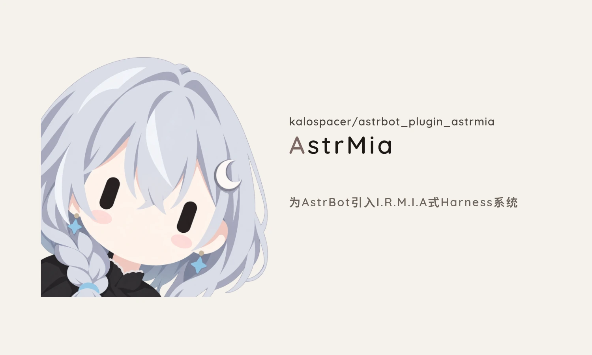

<div align="center">
  <picture>
    <source media="(prefers-color-scheme: dark)" srcset="assets/banner-dark.webp" />
    
  </picture>
</div>

**AstrMia** 让你的 AstrBot 在所有群聊和私聊里共用同一段记忆。群里没人叫她时，消息自动收进未读信箱并生成话题摘要；没人说话时，她会隔一阵子自己醒来翻翻群聊、主动找人搭话。

## 效果预览

**1. 跨群连贯记忆 + 群消息信箱**

她在每次对话时都能看到所有群和私聊的动向，知道每个群在聊什么、自己多久没去说话了：

```text
外部会话：
- 单聊 · 管理员｜sid aiocqhttp:FriendMessage:10001｜最后 04-15 21:10｜我上次在这说话：5 分钟前
- 群聊 · 水群｜sid aiocqhttp:GroupMessage:20002｜最后 04-15 21:08｜今天 2 段 / 历史 5 段｜在聊：讨论晚饭吃什么｜我上次在这说话：2 小时前
```

**2. 群里被点名时自带上下文**

群里没人 @ 她或提她名字时，消息只攒着不打扰；一旦有人叫她，插件自动把前后文打包递给她，不用每句话都触发回复：

```text
21:08，水群 里有人提到了你（是 群友A），那边一共有 6 条未读。那边在聊：讨论晚饭吃什么。
下面是叫你的消息和前后文：
[21:06 #41] 群友A: 今晚吃啥
[21:07 #42] 群友B: 火锅？
▶ [21:08 #43] 群友A: 弥亚觉得呢
```

**3. 没人找她时自己醒来**

安静 5～60 分钟后（平均约 15 分钟），她会自己醒来翻看信箱或待办，遇到感兴趣的话题主动插话，或者去私聊找你。

**4. 查看运行状态（`/astrmia status`）**

```text
=== AstrMia 运行状态 ===
总开关：开启
全局主脑会话：aiocqhttp:FriendMessage:10001
AstrHe 账本/关系本联动：已连接
呼吸心跳：开启 （区间 5~60m · 目标均值 15.0m）
当前安静时长：12.4 分钟（下一拍抽中概率 p=0.092，这段时间自己醒了 1 次）
已知外部会话数：2
  - 管理员 (aiocqhttp:FriendMessage:10001)：未读 0 / 总计 48
  - 水群 (aiocqhttp:GroupMessage:20002)：未读 6 / 总计 312 · 话题：讨论晚饭吃什么
```

## 安装

### 方式一：AstrBot 面板安装

打开 AstrBot 管理面板 → **插件** → **安装插件**，填入仓库地址：

```text
https://github.com/Kalospacer/astrbot_plugin_astrmia
```

### 方式二：命令行安装

在 AstrBot 的 `data/plugins` 目录下执行：

```bash
git clone https://github.com/Kalospacer/astrbot_plugin_astrmia
```

> 需要 AstrBot `>= 4.16`。装了 [AstrHe](https://github.com/Kalospacer/astrbot_plugin_astrhe) 会自动共用聊天记录和联系人备注，不装也能单独使用。

## 快速配置

装好插件后，去插件配置里填这三项就能跑起来：

1. **绑定主脑会话（`master_umo`）**：留空即可，用管理员账号私聊机器人发一句话会自动绑定。
2. **填写称呼（`mention_keywords`）**：填机器人的名字或昵称（如 `弥亚`）。群里有人提到这些词就会叫醒她。
3. **选择小模型（`light_provider_id`）**：选一个便宜、响应快的小模型，用来在后台概括群话题。

## 全部配置项

### 基本与信箱

| 配置项 | 默认值 | 说明 |
|---|---|---|
| `enabled` | `true` | 插件总开关 |
| `master_umo` | 空 | 记忆所在的会话（如 `aiocqhttp:FriendMessage:10001`），留空自动绑定第一个私聊的管理员 |
| `mention_keywords` | `[]` | 机器人的称呼列表，群聊里提到这些词会叫醒她 |
| `contacts_map` | `[]` | 联系人与群聊备注，每行一条 `QQ号或群号 = 名字` |
| `group_batch_enabled` | `true` | 群友连续发多条点名消息时，先等几秒凑齐再一起叫醒 |
| `private_batch_enabled` | `true` | 私聊连续发多条消息时，先等几秒凑齐再一起交给她 |
| `group_batch_window_sec` | `3` | 连续发消息时的合并等待秒数（群聊和私聊共用） |
| `mention_inline_enabled` | `true` | 群里被叫到时，通知里直接附上点名消息和前后文 |
| `mention_inline_limit` | `20` | 通知里最多附带多少条上下文消息 |
| `intercept_direct_reply` | `false` | 开启后，如果本轮已经用发消息工具回过当前窗口，末尾直接写的文字不再重复发出 |

### 自己醒来（呼吸心跳）

| 配置项 | 默认值 | 说明 |
|---|---|---|
| `heartbeat_enabled` | `true` | 没人说话时是否定期自己醒来 |
| `heartbeat_provider_id` | 空 | 自己醒来时使用的模型，留空则与主会话相同 |
| `heartbeat_prompt` | 内置文案 | 醒来时的行动提示词，支持 `{quiet_min}`（已安静分钟数）和 `{idle_ticks}`（本轮安静期间醒来次数） |
| `heartbeat_floor_min` | `5` | 最短安静分钟数，刚聊完不到这个时间不会自己醒来 |
| `heartbeat_ceil_min` | `60` | 最长安静分钟数，安静满这个时间必定醒来一次 |
| `heartbeat_target_mean_min` | `15` | 平均多少分钟自己醒来一次 |
| `heartbeat_quiet_enabled` | `false` | 夜间免打扰开关，开启后在指定时段内不自己醒来 |
| `heartbeat_quiet_start_hour` | `22` | 免打扰开始整点（0～23） |
| `heartbeat_quiet_end_hour` | `8` | 免打扰结束整点（0～23） |
| `wake_options.summary_max_chars` | `60` | 醒来后如果做了事，写入记忆的摘要字数上限 |
| `wake_options.tick_sec` | `60` | 后台每隔多少秒判定一次要不要醒来 |
| `wake_options.max_steps` | `32` | 单次醒来最多可执行的工具调用步数 |

### 话题概括与清单显示

| 配置项 | 默认值 | 说明 |
|---|---|---|
| `light_provider_id` | 空 | 用于概括群话题和生成醒来摘要的小模型 |
| `topic_min_unread` | `5` | 群未读消息攒够多少条后触发后台话题概括 |
| `topic_cooldown_sec` | `180` | 同一个群两次话题概括之间的最短间隔秒数 |
| `topic_options.max_chars` | `24` | 会话清单里群话题摘要的字数上限 |
| `topic_options.context_messages` | `25` | 每次概括群话题时读取最近多少条消息 |
| `topic_options.line_max_chars` | `120` | 概括时单条消息保留的最大字数 |
| `topic_options.timeout_sec` | `10` | 小模型请求超时秒数 |
| `topic_options.segment_rows_per_page` | `10` | 读群目录一次展示多少个消息分段 |
| `topic_options.segment_msg_count` | `25` | 每多少条群消息切成一个分段并生成摘要 |
| `topic_options.segment_backfill_max` | `5` | 群消息积压时单次最多补齐多少个分段的摘要 |
| `display_options.session_list_max` | `8` | 会话清单最多展示最近几个群或私聊 |
| `display_options.quote_preview_chars` | `40` | 群消息引用回复时保留的被引用文字长度 |

### 群聊识图

| 配置项 | 默认值 | 说明 |
|---|---|---|
| `image_keep_days` | `3` | 聊天图片在本地缩略留底的天数（填 `0` 不保存） |
| `read_channel_image_enabled` | `true` | 读群时自动识别图片并附上文字描述 |
| `read_channel_image_max` | `6` | 单次读群最多新识别几张图片 |
| `read_channel_image_wait_sec` | `8` | 读群等待识图的最长秒数，超时未完成的转入后台继续识别 |
| `image_brief_max_chars` | `80` | 读群和概括话题时单张图片描述的字数上限 |
| `read_image_max_chars` | `500` | 主动调用看图工具查看图片细节时的回答字数上限 |
| `vision_provider_ids` | `[]` | 识图模型列表，按顺序尝试，留空则使用小模型 |
| `vision_timeout_sec` | `60` | 单次识图请求超时秒数 |
| `topic_image_caption_enabled` | `true` | 概括群话题时是否带上图片描述 |
| `vision_cache_ttl_days` | `30` | 图片描述缓存的保留天数 |

## 管理员指令

| 指令 | 作用 |
|---|---|
| `/astrmia status` | 查看当前绑定会话、心跳倒计时和各群信箱状态 |
| `/astrmia wake [备注]` | 立即叫醒她一次（可附带一句提示） |
