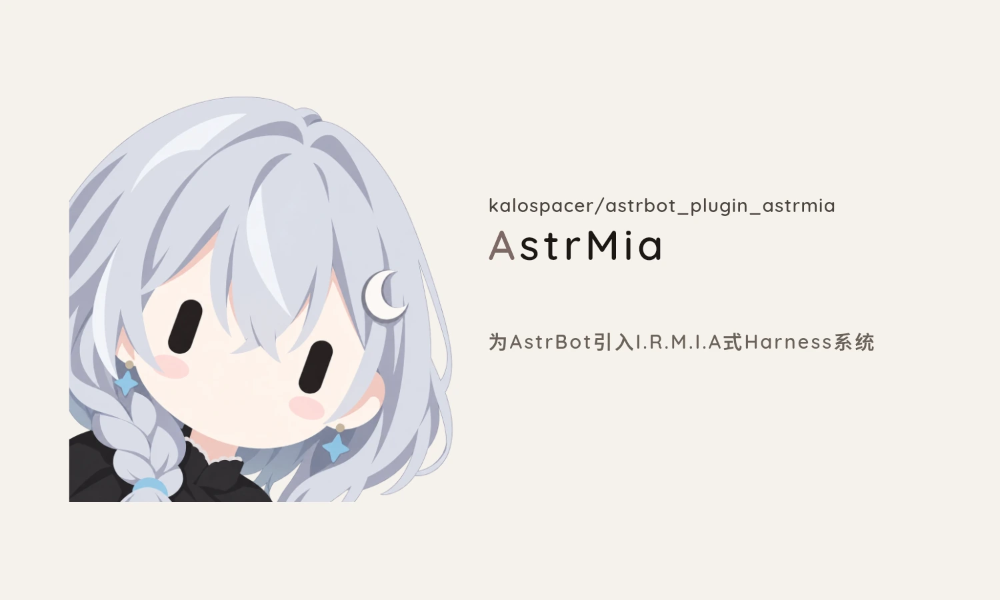

<div align="center">
  <picture>
    <source media="(prefers-color-scheme: dark)" srcset="assets/banner-dark.webp" />
    
  </picture>
</div>

**AstrMia** 让 AstrBot 在所有群聊与私聊间共享同一段记忆：未唤醒的消息进入未读信箱并自动生成话题摘要；空闲时按概率自主唤醒，主动查看会话并发送消息。

## 功能

- **共享记忆**：所有会话绑定同一主对话，跨群、跨私聊记忆连续
- **未读信箱**：群聊中未唤醒机器人的消息仅记为未读，不触发回复；按分段自动生成话题摘要
- **关键词唤醒**：群消息命中配置的关键词或 @ 机器人时唤醒，通知附带命中消息与前后文
- **自主唤醒**：空闲时按概率触发主动对话轮，可查看会话、执行待办、主动发送消息；支持夜间免打扰
- **定时任务接管**：AstrBot 定时任务在共享记忆上执行，结束后把小结写回同一段记忆
- **活跃对话跟进**：机器人在群里发言后的几分钟内，有人没带 @ 接话时由判定模型决定是否唤醒
- **话题概括**：由小模型分段总结群聊，用于会话清单与 read_channel 分段目录（可关闭）
- **群聊识图**：群内图片自动生成文字描述，供模型与 read_image 工具使用
- **AstrHe 联动**：安装 [AstrHe](https://github.com/Kalospacer/astrbot_plugin_astrhe) 后共用聊天账本与联系人备注，未安装亦可独立使用

## 工作方式

| 消息场景 | 行为 |
|---|---|
| 私聊 | 始终唤醒并直接回复 |
| 群聊 @ 机器人 | 立即唤醒，通知附带命中消息与前后文 |
| 群聊命中关键词 | 同上 |
| 机器人发言后 5 分钟内的群接话 | 合并 6 秒内的消息交给判定模型，判定该接话时按点名流程唤醒 |
| 其他群消息 | 仅记为未读，不唤醒；后台生成话题摘要（始终保留最新 10 条原文不切段） |
| 空闲达到设定区间 | 按概率自主唤醒，模型通过工具查看会话并发送消息 |
| 定时任务到期 | 在共享记忆上执行任务，结束后写入 `[CronJob]` 小结 |

模型侧提供两个工具：`read_channel`（查看会话消息与分段摘要）、`read_image`（查看消息中的图片）。不带参数调用 `read_channel` 时返回全部未读和紧挨着的两条前文，单条消息超过 `display_options.msg_max_chars` 字时截断显示。

## 效果示例

每次对话注入的会话清单（模型可见）：

```text
外部会话：
- 单聊 · 管理员｜sid aiocqhttp:FriendMessage:10001｜最后 04-15 21:10｜无新消息｜我上次在这说话：5 分钟前
- 群聊 · 水群｜sid aiocqhttp:GroupMessage:20002｜最后 04-15 21:08｜未读 12 条｜今天 2 段 / 历史 5 段｜在聊：讨论晚饭吃什么｜我上次在这说话：2 小时前
```

群聊被点名时，通知分两部分。触发事实写入共享记忆：

```text
[群聊 · 水群 · sid aiocqhttp:GroupMessage:20002 · 21:08 · 提到了你（群友A）]
[21:08 #43] 群友A: 弥亚觉得呢
```

前情只在本轮可见，保存记忆时自动剥离：

```text
该会话共 6 条未读。那边在聊：讨论晚饭吃什么。
以下为触发消息的前情，已读并更新水位，无需再次 read_channel 该会话（sid=aiocqhttp:GroupMessage:20002）：
[21:06 #41] 群友A: 今晚吃啥
[21:07 #42] 群友B: 火锅？
需要更早的记录时传 before=41 往前翻（翻页不改已读）。
是否回复由你决定。
```

## 安装

### 方式一：AstrBot 面板安装

打开 AstrBot 管理面板 → **插件** → **安装插件**，填入仓库地址：

```text
https://github.com/Kalospacer/astrbot_plugin_astrmia
```

### 方式二：命令行安装

在 AstrBot 的 `data/plugins` 目录下执行：

```bash
git clone https://github.com/Kalospacer/astrbot_plugin_astrmia
```

> 需要 AstrBot `>= 4.16`。

## 快速上手

1. **绑定主会话（`master_umo`）**：留空即可，首次用管理员账号私聊机器人时自动绑定。
2. **配置唤醒关键词（`mention_keywords`）**：填机器人的名字或昵称（如 `弥亚`），群聊消息命中任一关键词即触发唤醒。
3. **选择话题概括模型（`light_provider_id`）**：选择用于后台话题摘要的低成本模型，留空时使用会话默认模型。

## 全部配置项

### 基础

| 配置项 | 默认值 | 说明 |
|---|---|---|
| `enabled` | `true` | 插件总开关。关闭后群消息不进信箱、不注入共享记忆、不自主唤醒 |
| `master_umo` | 空 | 全局共享记忆绑定的会话（unified_msg_origin），留空时首次管理员私聊自动绑定 |
| `mention_keywords` | `[]` | 群聊唤醒关键词，正文命中任一即唤醒（大小写不敏感）；@ 与私聊始终唤醒 |
| `contacts_map` | `[]` | 联系人备注，每行一条 `QQ号或群号 = 显示名`，优先于 AstrHe 关系本 |
| `group_batch_window_sec` | `3` | 消息合并等待秒数，窗口内的连续消息合并为一次对话轮；`0` 禁用合并 |
| `mention_inline_enabled` | `true` | 点名通知附带命中的消息与前后文并标记已读 |
| `intercept_direct_reply` | `false` | 本轮已用工具向当前会话发送过消息时，丢弃模型末尾直出文本 |
| `takeover_cron` | `true` | 定时任务在共享记忆上执行并写回小结，使用 `heartbeat_provider_id` 模型；关闭或未绑定主会话时走 AstrBot 原生流程 |

### 自主唤醒

| 配置项 | 默认值 | 说明 |
|---|---|---|
| `heartbeat_enabled` | `true` | 空闲时按概率周期性触发主动对话轮；关闭后仅响应 @、关键词与私聊 |
| `heartbeat_provider_id` | 空 | 唤醒对话轮、唤醒小结与接管的定时任务共用的模型，留空使用主会话默认模型 |
| `heartbeat_prompt` | 内置文案 | 唤醒时注入的指令，支持 `{quiet_min}` 与 `{idle_ticks}` 占位符；留空或未修改默认时按是否安装 AstrHe 自动适配 |
| `heartbeat_quiet_enabled` | `false` | 夜间免打扰，时段内暂停自主唤醒抽签 |
| `heartbeat_quiet_start_hour` | `22` | 免打扰开始整点（0~23），晚于结束整点表示跨零点窗口 |
| `heartbeat_quiet_end_hour` | `8` | 免打扰结束整点（0~23） |

### 话题概括

| 配置项 | 默认值 | 说明 |
|---|---|---|
| `topic_summary_enabled` | `true` | 话题概括开关。关闭后不调用概括模型、读群仅返回原文；已生成的摘要与进度保留，重新开启后继续 |
| `light_provider_id` | 空 | 话题摘要模型，建议选择低成本模型；留空使用会话默认模型 |

### 群聊识图

识图提示词与首选模型与 AstrBot 主对话的图片转述配置保持一致。

| 配置项 | 默认值 | 说明 |
|---|---|---|
| `read_channel_image_enabled` | `true` | 识图开关，在 `read_channel` 与点名时按需识图；话题概括仅复用已有缓存 |
| `vision_provider_ids` | `[]` | 识图兜底模型链，核心未配置图片转述模型时按顺序尝试 |
| `image_keep_days` | `3` | 图片留底天数，供 `read_image` 回看；`0` 不存档 |

### 高级参数

#### `topic_options`（话题概括参数）

| 配置项 | 默认值 | 说明 |
|---|---|---|
| `topic_options.cooldown_sec` | `180` | 触发冷却秒数，失败的尝试同样计入 |
| `topic_options.max_chars` | `24` | 话题摘要字数上限 |
| `topic_options.line_max_chars` | `120` | 单条消息截断字数 |
| `topic_options.timeout_sec` | `10` | 模型请求超时秒数 |
| `topic_options.segment_msg_count` | `25` | 分段消息条数（攒满整段才触发概括） |
| `topic_options.segment_rows_per_page` | `10` | 分段目录每页条数 |
| `topic_options.segment_backfill_max` | `5` | 积压时单次补充分段上限 |

#### `heartbeat_options`（自主唤醒参数）

| 配置项 | 默认值 | 说明 |
|---|---|---|
| `heartbeat_options.floor_min` | `5` | 最短空闲分钟，不足不触发 |
| `heartbeat_options.ceil_min` | `60` | 最长空闲分钟，达到必触发 |
| `heartbeat_options.target_mean_min` | `15` | 平均唤醒间隔分钟，自动重算概率分布 |
| `heartbeat_options.tick_sec` | `60` | 抽签间隔秒数 |
| `heartbeat_options.max_steps` | `32` | 单轮最大工具步数 |
| `heartbeat_options.summary_max_chars` | `60` | 唤醒小结字数上限 |

#### `vision_options`（识图参数）

| 配置项 | 默认值 | 说明 |
|---|---|---|
| `vision_options.image_max` | `6` | 单次新识别图片上限 |
| `vision_options.wait_sec` | `8` | 读群等待识图秒数，超时转入后台 |
| `vision_options.brief_max_chars` | `80` | 消息行描述截断字数（自动剥离 Markdown 标题壳） |
| `vision_options.read_max_chars` | `500` | `read_image` 单次返回字数上限（超长支持 `offset` 续读），0 表示不限制 |
| `vision_options.timeout_sec` | `60` | 单次识图请求超时秒数 |
| `vision_options.cache_ttl_days` | `30` | 描述缓存保留天数 |

#### `display_options`（显示参数）

| 配置项 | 默认值 | 说明 |
|---|---|---|
| `display_options.session_list_max` | `8` | 会话清单最大条数 |
| `display_options.quote_preview_chars` | `40` | 引用预览字数 |
| `display_options.inline_limit` | `20` | 点名通知内嵌消息上限 |
| `display_options.attention_window` | `10` | 后台分段始终保留的最新原文条数，未归档达到「分段条数 + 本值」才概括 |
| `display_options.msg_max_chars` | `150` | 单条消息纯文本显示上限，图片描述不受影响；`0` 不截断 |

#### `active_options`（活跃对话跟进）

| 配置项 | 默认值 | 说明 |
|---|---|---|
| `active_options.window_sec` | `300` | 发言后关注秒数，`0` 关闭 |
| `active_options.debounce_sec` | `6.0` | 合并判定秒数，从第一条接话开始计时，不因新消息延长 |
| `active_options.max_consecutive` | `5` | 连续跟进上限，再次被 @ 或命中关键词后清零 |
| `active_options.threshold` | `0.6` | 唤醒阈值（专用决策接口比较概率，`llm` 模式比较三维 0~4 加权归一化得分） |
| `active_options.mode` | `decision_api` | 判定模式：`decision_api`（专用决策接口）或 `llm`（AstrBot 对话模型） |
| `active_options.provider_id` | 空 | `llm` 模式必填，显式指定 AstrBot 对话模型（留空不启用，不回退） |
| `active_options.protocol` | `gemini_decisions` | `decision_api` 模式的接口协议：`gemini_decisions`、`systemone`、`openai_decisions`（仅决定协议格式，不绑定模型名） |
| `active_options.api_base` | 空 | `decision_api` 模式必填，服务根地址（不含尾部接口路径，留空不启用） |
| `active_options.api_key` | 空 | `decision_api` 模式必填，接口密钥（`systemone` 留空读取环境变量 `TYPESAFE_API_KEY`） |
| `active_options.model` | 空 | `decision_api` 模式必填，填写目标服务支持的决策模型 ID（无默认硬编码，留空不启用） |

各模式 / 接口协议的请求方式：

| 模式 / 协议 | 请求 | 鉴权 | 图片 |
|---|---|---|---|
| `systemone` | `POST {api_base}/v1/systemone` | `Authorization: Bearer` | 仅复用已有识图描述 |
| `gemini_decisions` | `POST {api_base}/v1beta/decisions` | `x-goog-api-key` | 附带最多 3 张留底图 |
| `openai_decisions` | `POST {api_base}/v1/decisions` | `Authorization: Bearer` | 附带最多 3 张留底图 |
| `llm` | AstrBot 模型 `text_chat` | AstrBot 配置 | 仅复用已有识图描述 |

判定超时上限为 `min(topic_options.timeout_sec, 6)` 秒；请求失败时不唤醒。

## 指令

| 指令 | 作用 |
|---|---|
| `/astrmia status` | 查看绑定会话、唤醒参数与各会话未读状态 |

`/irmia` 为兼容别名，子指令相同。
